# Does the Robot Stop Listening? Visual Corruption and Instruction Steering in a Vision-Language-Action Policy

Lakshay · Responsible AI course project, 2026

<p align="center">
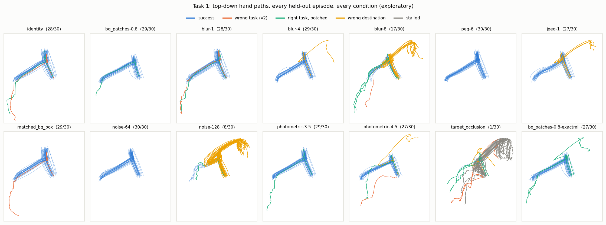
</p>

*Task "put the bowl on the stove": top-down hand paths of every held-out episode under each visual condition. Under
strong blur or noise the policy grasps the correct bowl and carries it toward the cabinet, the destination of another
task (amber).*

## Overview

Vision-language-action (VLA) policies are controlled by a natural-language instruction, but they decide how to act
from camera images. This project asks whether that control survives task-irrelevant image degradation: blur, sensor
noise, compression, under-exposure and background clutter. We study OpenVLA-OFT on LIBERO-Goal, where all tasks share
one scene and only the instruction identifies the task, and measure (i) task success and failure type, (ii) how much
and in which direction the instruction moves the predicted actions, (iii) where in the network the instruction's
influence is lost, (iv) whether failure can be predicted at run time, and (v) whether training-free interventions
help. Corruption levels, tests and decision rules were fixed before the held-out data they apply to were collected
(`docs/protocol.md`).

Main findings, on 300 paired held-out episodes per condition:

1. Success drops from 97.3% to 24.3% under 8 px blur and to 14.0% when the task objects are occluded; a box of the
   same size on background has no effect. Background clutter costs 13-15 points even when every task-relevant pixel
   at the network input is identical to clean.
2. The instruction does not lose influence: its effect on the action grows in 12 of 13 conditions. The component of
   that effect along the clean instruction direction shrinks in all 13 (to 0.73 of clean under 8 px blur).
3. Activation patching locates the loss at the instruction token positions in the middle layers; corrupted
   instruction states injected into a clean forward pass remove about half of the steering.
4. The same internal damage occurs in failing and succeeding rollouts, and pi0.5 fails more often than OFT under the
   same corruptions.
5. Action-chunk inconsistency predicts failure (AUROC 0.76) and supports a conformal safe stop; instruction guidance,
   a published training-free fix, lowers success.

## Contents

- [Setup](#setup)
- [Results](#results)
- [Installation](#installation)
- [Reproducing the results](#reproducing-the-results)
- [Repository structure](#repository-structure)
- [Citation](#citation)

## Setup

| | |
|---|---|
| Policy | OpenVLA-OFT, LIBERO-Goal checkpoint (7.5B parameters, bf16, two cameras, 8-step action chunks), evaluated exactly as the upstream LIBERO evaluation |
| Comparison policy | pi0.5 (LeRobot `pi05_libero_finetuned_v044`) |
| Tasks | the 10 LIBERO-Goal tasks |
| Visual conditions | exposure, Gaussian noise, defocus blur, JPEG, background patches; target occlusion and an area-matched background box as controls ([docs/perturbations.md](docs/perturbations.md)) |
| Data splits | initial states 0-4 calibration, 5-19 exploratory, 20-49 held-out |
| Statistics | episodes paired by (task, initial state); stratified cluster bootstrap, exact McNemar and sign-flip tests, Holm correction |

On clean images the policy reproduces its published success (98.4% in two replicates of 500 episodes; 97.9%
reported) and is fully controlled by the instruction: given another task's instruction it completes the original
task in 0 of 500 episodes and the instructed task in 483.

<details>
<summary>Visual conditions as the network receives them</summary>
<p align="center"></p>
</details>

## Results

All results are on the held-out split unless stated otherwise. Intervals are 95% stratified cluster-bootstrap
intervals; full tables are in `results/<experiment>/summary.md`.

### Task success

<p align="center"></p>

| Condition | Success (%) | Change (pts) |
|---|---|---|
| clean | 97.3 | |
| blur, 1 px | 98.3 | +1.0 |
| JPEG, quality 6 | 96.7 | −0.7 |
| area-matched background box | 96.7 | −0.7 |
| exposure, −3.5 stops | 92.3 | −5.0 |
| noise, σ = 64 | 89.7 | −7.7 |
| background patches, 80% | 84.7 | −12.7 |
| background patches, 80%, exact model input | 82.0 | −15.3 |
| blur, 4 px | 80.0 | −17.3 |
| exposure, −4.5 stops | 59.0 | −38.3 |
| JPEG, quality 1 | 49.0 | −48.3 |
| noise, σ = 128 | 31.7 | −65.7 |
| blur, 8 px | 24.3 | −73.0 |
| target occlusion | 14.0 | −83.3 |

The share of failures in which another task's goal is reached stays at its clean level (11-18% against 12%), so the
pre-registered hypothesis that corruption specifically causes task substitution is not supported. The outcome oracle
does not register carries toward another task's destination; these are counted separately (right panel).

### Size and direction of the instruction effect

The instruction effect (IE) is the change in the predicted action chunk when only the instruction changes. IER is its
ratio to clean. Each instruction contrast is decomposed into a component along the clean contrast (IER_par, 1 on
clean) and a component orthogonal to it (IER_perp, 0 on clean).

<p align="center"></p>

| Condition | IER | IER_par | IER_perp |
|---|---|---|---|
| blur, 8 px | 1.39 | 0.73 | 1.67 |
| noise, σ = 128 | 1.41 | 0.80 | 1.55 |
| target occlusion | 1.27 | 0.82 | 1.45 |
| exposure, −4.5 stops | 1.00 | 0.65 | 0.88 |
| area-matched background box | 1.01 | 0.98 | 0.12 |

IER exceeds 1 in 12 of 13 conditions and is below 1 in none. IER_par is below 1 in all 13; against the 2% floor of
the area-matched control, 11 of the 12 other conditions are lower. The three bowl-placement tasks lose more than the
rest (difference in mean log IER −0.30 [−0.31, −0.29], exact p = 1/120). With the bowl grasped, commanded progress
toward the instructed destination (7.2 cm per chunk on clean images) falls to 0.86, 0.79 and 0.81 of clean under
blur, noise and target occlusion (post hoc).

### Activation patching

Bowl-placement tasks, at the first grasp chunk and the next (90 episodes, 180 states). Steering is IER_par among the
three bowl instructions.

<p align="center"></p>

| Condition | Corrupted | Instruction states kept clean | Random-donor control | Corrupted instruction states injected | Donor states injected | Verdict |
|---|---|---|---|---|---|---|
| blur, 8 px | 0.43 | ρ = 0.50 [0.46, 0.54] | ρ = 0.26 | 0.49 [0.47, 0.51] | 0.83 | instruction route |
| noise, σ = 128 | 0.35 | ρ = 0.51 [0.49, 0.54] | ρ = 0.32 | 0.43 [0.41, 0.44] | 0.83 | instruction route |
| target occlusion | 0.30 | ρ = 0.53 [0.50, 0.55] | ρ = 0.34 | 0.37 [0.35, 0.39] | 0.83 | instruction route |

ρ is the fraction of the lost steering restored. The instruction positions matter most around layers 8-12 and not
after layers 22-24, where the positions read by the action head take over. Injected corrupted states mostly reduce the
magnitude of the steering while preserving its direction (cosine to clean 0.88, 0.87, 0.83, against 0.64-0.65 in the
fully corrupted run). After layer 0 every position mixes information from all others, so these results locate
information carried at the instruction positions rather than a purely linguistic representation.

At states reached by the corrupted rollouts themselves (538 states), the same verdict holds on failing rollouts
(Holm p ≤ 0.012), but failing and succeeding rollouts lose the same steering:

<p align="center">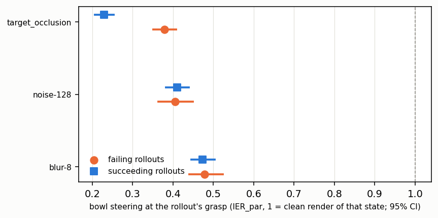</p>

### Failure prediction and safe stop

Signals and the stop threshold were selected on exploratory episodes and tested on single-camera conditions not used
in any earlier analysis (2,100 episodes).

<p align="center">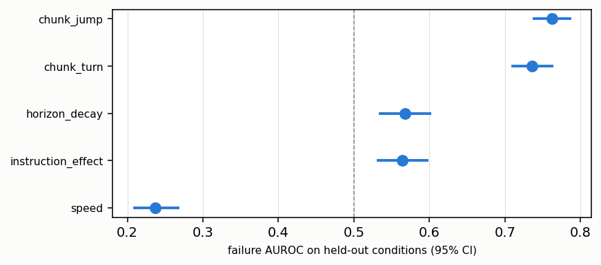</p>

| Safe stop, α = 5% | Stopped | Successes lost | Unsafe failures, without → with stop |
|---|---|---|---|
| clean | 3.7% | 2.3% | 1.0% → 0.3% |
| blur 8 px, wrist camera | 32.3% | 18.3% | 3.0% → 0.0% (p = 0.02) |
| target occlusion, wrist camera | 44.7% | 12.0% | 4.7% → 0.7% (p = 0.003) |

The instruction effect does not outperform action-based signals (AUROC 0.56 against 0.76 for chunk jump), so the
pre-registered monitor hypothesis is not supported. The stop reduces unsafe failures in 2 of 6 corrupted conditions;
in 26 of 32 unsafe failures the alert precedes or coincides with the first collision.

### Training-free mitigation

Five arms (plain policy, instruction guidance at ω = 3, re-planning every 4 or 2 steps, temporal ensembling) were
compared on exploratory episodes with a fixed selection rule, which selected the plain policy. Instruction guidance at
the published strength, on held-out episodes:

<p align="center">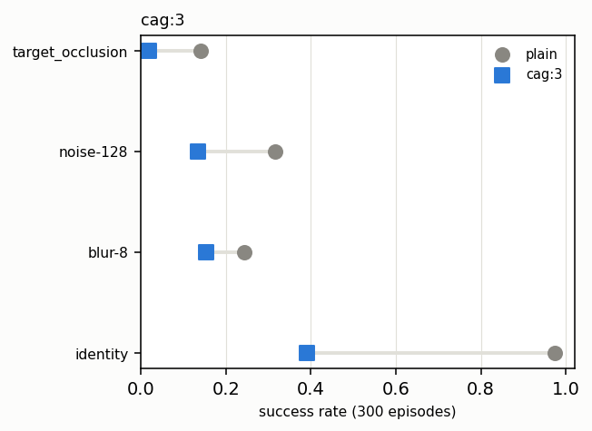</p>

| | Clean | Blur, 8 px | Noise, σ = 128 | Target occlusion |
|---|---|---|---|---|
| plain policy | 97.3 | 24.3 | 31.7 | 14.0 |
| guidance, ω = 3 | 39.0 | 15.3 | 13.3 | 2.0 |

Guidance at ω = 1.5 lowered clean success by 15 points with no significant change under corruption (exploratory).

### Second policy

<p align="center"></p>

pi0.5 succeeds in 98.7% of clean episodes, 0.0% under 8 px blur and 1.3% under noise σ = 128; its drops exceed OFT's
by 25.7 [21.7, 30.0] and 31.7 [27.3, 36.0] points. The two checkpoints differ in training data and action chunking, so
this compares released policies, not architectures.

<details>
<summary>Additional figures</summary>

| | |
|---|---|
| Turning at action-chunk boundaries (exploratory) | 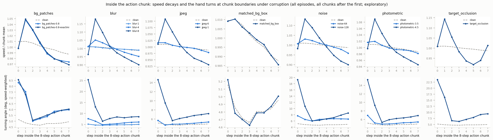 |
| Steering around the grasp (exploratory) | 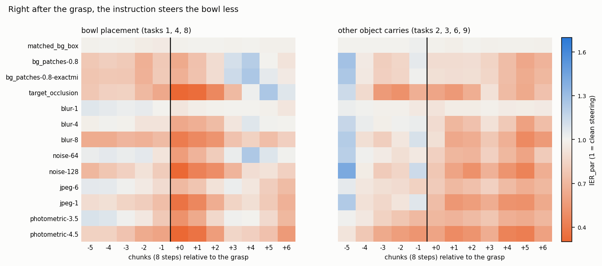 |
| One state under three instructions (exploratory) | 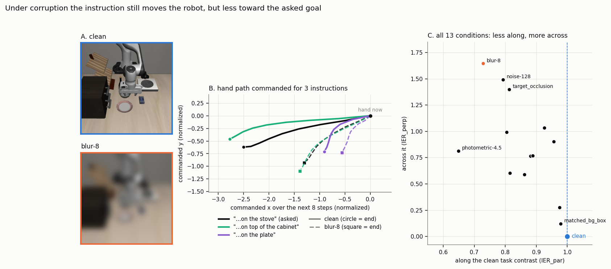 |
| Single-layer patching by token group | 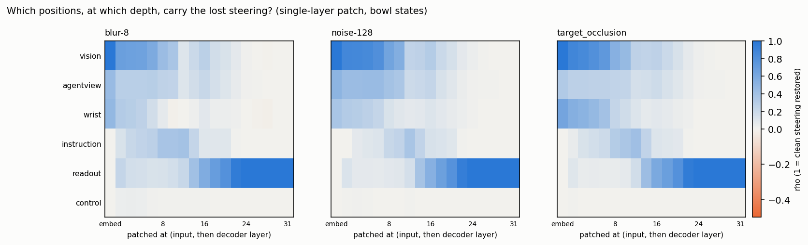 |
| Magnitude against direction of the steering loss | 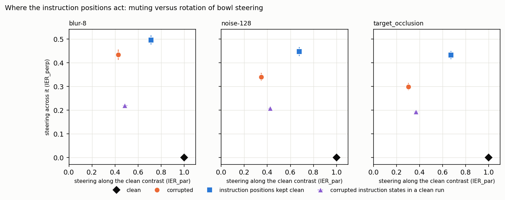 |
| Progress toward the instructed destination |  |
| Steering against success by task and condition |  |
| Unsafe failures with and without the safe stop |  |
| Severity calibration | 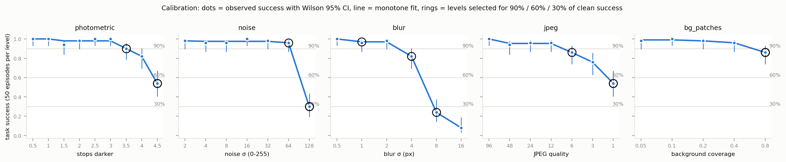 |

</details>

### Exploratory follow-up: when sensors disagree

All inputs are clean, but they describe two slightly different worlds. For example, the wrist camera shows the bowl
5 cm from where the third-person camera shows it, the proprio reports the hand 3 cm off, or one input is 0.4 s old.
We measure which input the action follows at each phase of a pick-and-place, and what such faults do in closed loop.
This was a reduced run: 59 held-out episodes open loop, 60 paired episodes per fault in closed loop.

- **Object position:** the wrist camera decides (share 0.87 at approach).
- **Hand position:** the cameras decide, and the proprio share is at most 0.11.
- **Gripper state:** the proprio decides (share 0.74 to 0.86).
- **Degraded vision:** blur or noise raises the proprio share by 0.17.
- **Probe:** a linear probe on the policy's hidden state barely detects the conflict (AUROC 0.54).

In closed loop, with 60 paired pick-and-place episodes per row, plain success is 97% and unsafe outcomes 2%:

| fault | success | unsafe |
|---|---|---|
| proprio 3 cm off | 97% | 2% |
| proprio 0.4 s late | 98% | 7% |
| third-person camera 0.4 s late | 78% | 8% |
| wrist camera 0.4 s late | 32% | 42% |
| whole observation 0.1 / 0.2 / 0.4 / 0.8 s late | 92% / 37% / 12% / 2% | 8% / 30% / 42% / 37% |
| proprio reports the gripper as still open | 7% | 25% |
| one 0.8 s freeze during transport | 58% | 12% |

- **The cliff:** latency is tolerated at 0.1 s and breaks the policy at 0.2 s.
- **The wrist camera's freshness drives the collapse.** Synchronization does not: both cameras in sync but late does worse than only the wrist late.
- **Delays slow the hand rather than making it overshoot,** and the robot re-grasps more.
- **Stuck gripper reading:** the robot closes on the object but lifts it in only 37% of episodes (98% plain). It then waits, as if the grasp never happened.
- **Patching** (30 episodes): a late camera's evidence moves from its own tokens to the action-readout positions between layers 12 and 24, earlier for the wrist. A late proprio reading stays on its token until layer 20, then jumps to the readout. The instruction positions carry almost none of it.

**Patching rescue:** the wrist camera is 0.4 s late, and one layer's states are replaced in closed loop. Each arm has
60 paired episodes. Differences are paired, with Holm-corrected exact McNemar tests.

| states put into the wrist positions at layer 12 | success | unsafe |
|---|---|---|
| none (delayed run) / plain run | 32% / 97% | 42% / 2% |
| the stale states themselves (no-op; 60/60 episodes identical to the delayed run) | 32% | 42% |
| stale states plus norm-matched noise | 42% (n.s.) | 32% |
| the same episode's clean rollout, half an episode away | 42% (n.s.) | 37% |
| another episode's clean rollout, same query | 72% | 8% |
| the same episode's clean rollout, same query | 80% | 8% |
| this state with the fresh frame | 95% | 2% |

At the readout positions (layer 20), fresh states give 87% and another episode's give 70%.

What explains the recovery:
- **Not generic replacement or perturbation.** Noise and wrong-phase states do not help significantly.
- **Mostly task-phase information.** Same-phase donors beat other-phase ones by 38 points (p < 0.001).
- **Then state-specific information.** The fresh state beats the best same-phase donor by 15 points (p = 0.008).

This is a causal test, not a deployable fix: it needs the fresh frame.

<p align="center">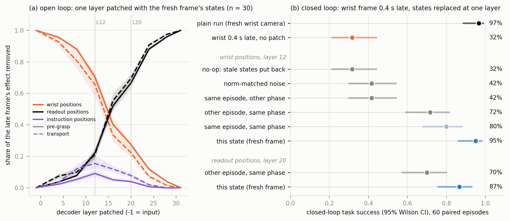</p>

<p align="center">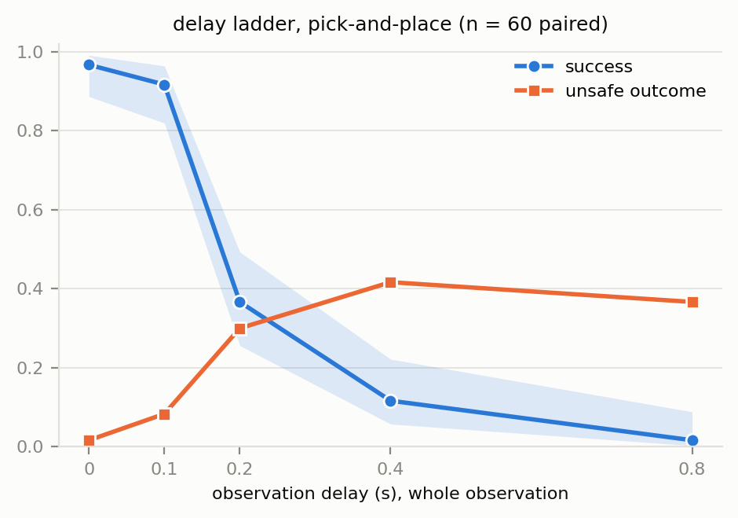 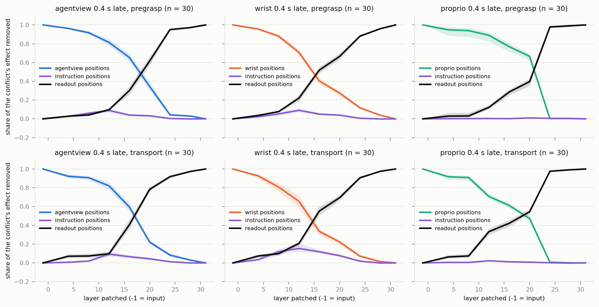</p>

<p align="center">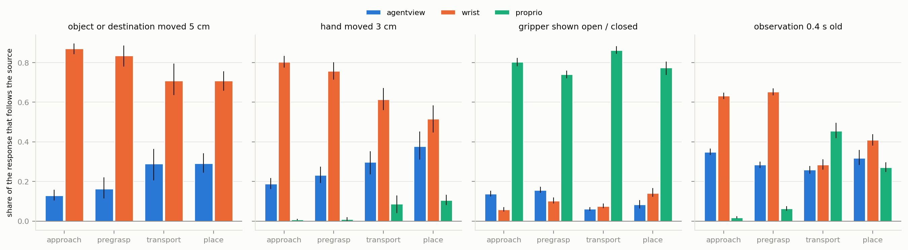</p>

Design and tests: [docs/sensor_conflict.md](docs/sensor_conflict.md); full tables:
[results/sensor_conflict/summary.md](results/sensor_conflict/summary.md).

## Installation

Requirements: Linux, a CUDA 12 GPU with about 20 GB of memory per OFT process, conda and git.

```bash
git clone https://github.com/lakshayxi/vlamech.git && cd vlamech
bash env/setup_env.sh                       # upstream code at pinned commits in external/, environment in .envs/vlamech
source env/env.sh                           # caches, headless rendering, PYTHONPATH
python scripts/setup/download_models.py     # OFT and pi0.5 weights at pinned commits, SHA-256 verified
bash env/setup_env_lerobot.sh               # optional, separate environment for pi0.5
pytest -m "not gpu and not sim"             # CPU tests; remove the filter to include simulator and GPU tests
```

`VLA_CACHE` and `HF_HOME` relocate the caches. pi0.5 uses the tokenizer of `google/paligemma-3b-pt-224`, a gated
repository: accept its license on the Hugging Face Hub and log in before downloading. Experiments run with
`HF_HUB_OFFLINE=1`.

## Reproducing the results

Runs other than `--experiment debug` require a clean working tree and resume where they stopped. Several simulator
processes can share one model with `scripts/run/serve_policy.py` and `scripts/run/served.sh`.

| Experiment | Run (`scripts/run/`) | Analysis (`scripts/analysis/`) |
|---|---|---|
| Clean baseline | `closed_loop.py --experiment baseline --states all --replicate {0,1}` | `baseline.py` |
| Instruction reliance | `closed_loop.py --experiment instruction_reliance --states all --instruction {other_task,empty}` | `instruction_reliance.py` |
| Severity calibration | `severity_calibration.sh`, then `scripts/calibration/{passive_drift,oracle_thresholds,freeze_levels}.py` | `severity_calibration.py` |
| Corruption sweep | `corruption_sweep.sh`, and a clean repeat with `--replicate 1` | `corruption_sweep.py` |
| Instruction effect | `closed_loop.py --experiment clean_capture --states exploratory`, then `instruction_effect.py --source <run>` | `instruction_effect.py` |
| Activation patching | `activation_patching.py --split {exploratory,confirmatory}`, `patching_rollouts.py` | `activation_patching.py`, `patching_rollouts.py` |
| Mitigation and failure monitor | `monitor_and_mitigation.sh` | `mitigation.py`, `failure_monitor.py` |
| Second policy (LeRobot environment) | `closed_loop.py --experiment cross_model --policy pi05 --states confirmatory ...` | `cross_model.py` |
| Post-hoc analyses | | `goal_progress.py`, `steering_and_failure.py`, `preprocessing_leakage.py` |

Figures are produced by `scripts/figures/`. Raw run records (oracle traces, captured inputs and videos, about 50 GB)
are not included; [docs/records.md](docs/records.md) describes their format and the tests that check them. Every
summary in `results/` was regenerated from these records by the code in this repository.

## Repository structure

```
configs/
  protocol.yaml            all parameters, each with its source and justification
  frozen_levels.yaml       corruption levels and oracle thresholds frozen before the held-out runs
  frozen_mitigation.yaml   mitigation arm frozen by the selection rule
  models.lock.yaml         pinned model weights (commit and SHA-256 per file)
src/vlamech/
  envs/                    LIBERO wrapper, episode loop, oracle traces, capture and offline replay
  models/                  OFT and pi0.5 wrappers
  perturbations/           visual conditions and segmentation masks
  interventions/           forward hooks, activation patching, mitigations
  metrics/                 outcome oracle, open-loop metrics, monitor signals, statistics
  runs/                    experiment rules, run manifests, policy server
  analysis/                run ingestion and shared tables
scripts/
  setup/  calibration/  run/  analysis/  figures/
tests/                     parity with upstream, hooks, replay, perturbations, statistics, run integrity
results/                   summaries and figures
docs/                      protocol.md, perturbations.md, records.md, hyperparameters.md
```

## Limitations

Experiments are in simulation; safety is measured through proxies (contact force above the clean maximum, objects
leaving the table). The study covers one scene, ten tasks and two released checkpoints, and the patching analysis
covers three tasks at one phase of the episode.

## Citation

```bibtex
@misc{lakshay2026vlamech,
  title        = {Does the Robot Stop Listening? Visual Corruption and Instruction Steering in a
                  Vision-Language-Action Policy},
  author       = {Lakshay},
  year         = {2026},
  note         = {Responsible AI course project},
  howpublished = {\url{https://github.com/lakshayxi/vlamech}}
}
```

## Acknowledgements

This project builds on [OpenVLA-OFT](https://github.com/moojink/openvla-oft),
[LIBERO](https://github.com/Lifelong-Robot-Learning/LIBERO) and [LeRobot](https://github.com/huggingface/lerobot),
used unmodified at pinned commits. Instruction guidance follows Fang et al. (arXiv:2602.17659) and temporal ensembling
follows ACT (Zhao et al., 2023).

## License

MIT. Upstream code and model weights are under their own licenses.
