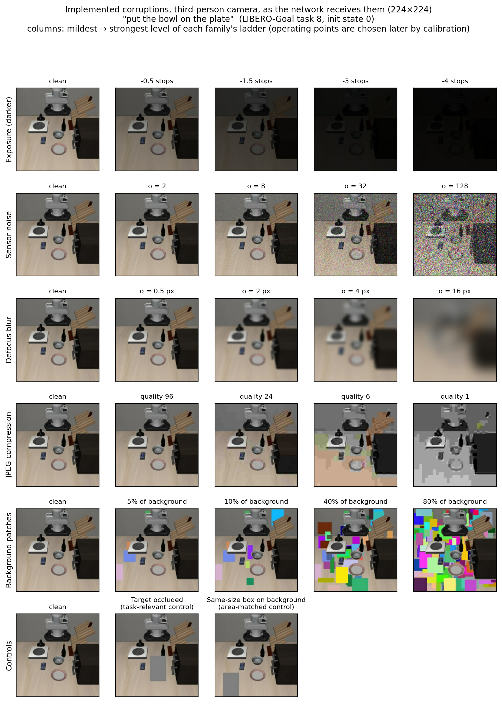
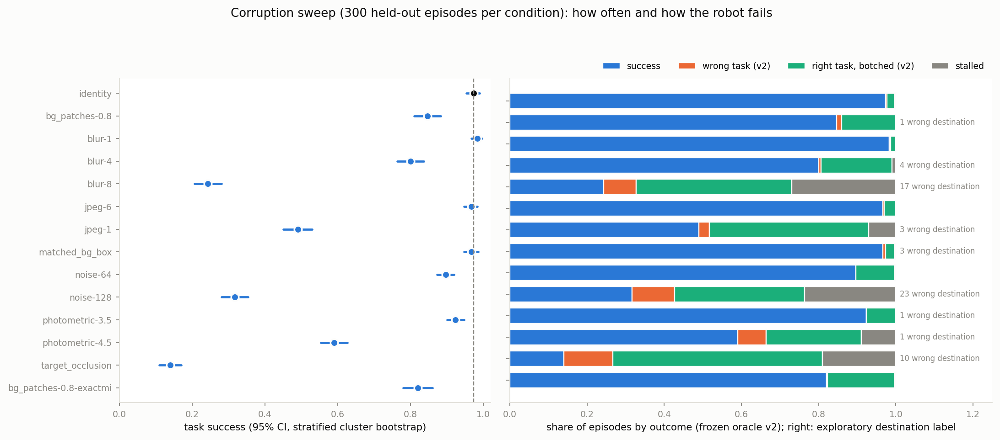
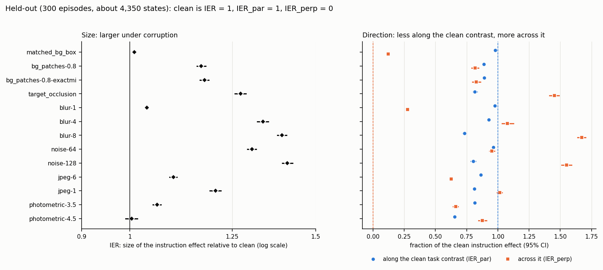
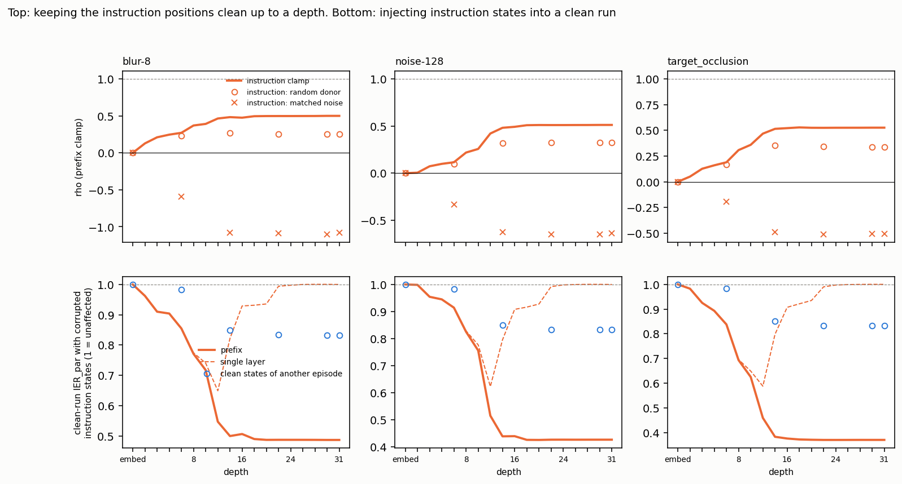
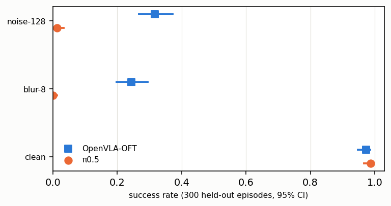
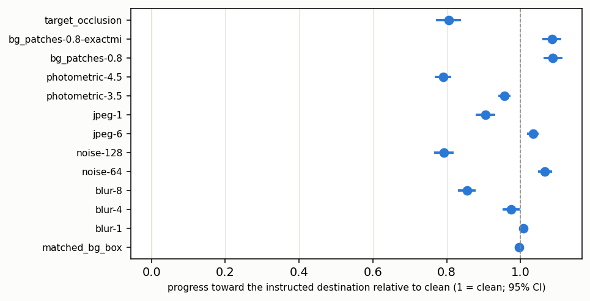
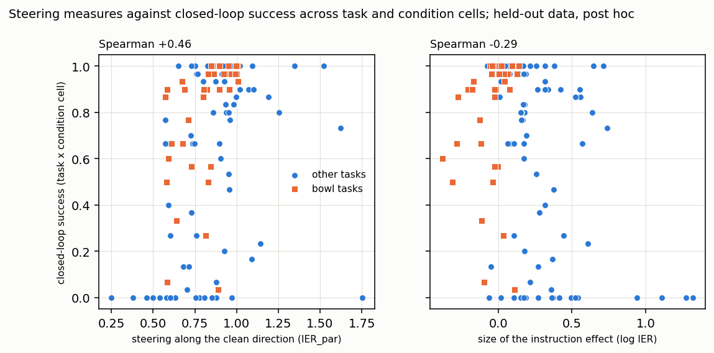
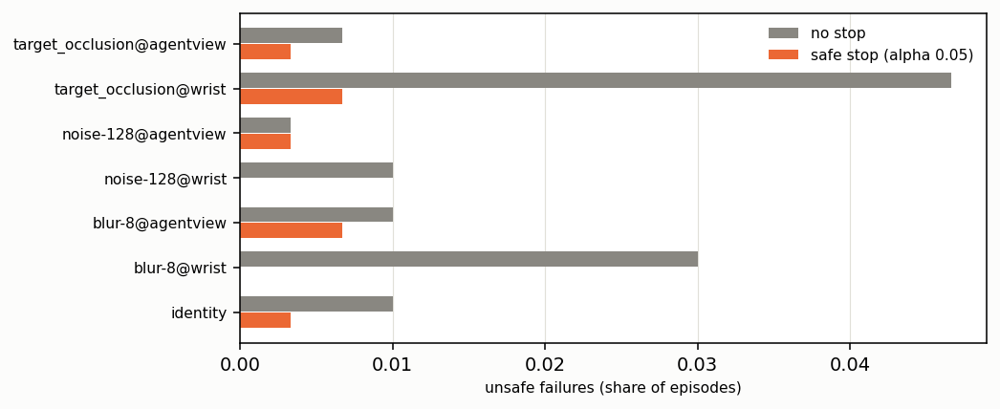

<div align="center">

# Does the Robot Stop Listening?

### Visual Corruption and Instruction Steering in a Vision-Language-Action Policy

**Lakshay** · Responsible AI course project, 2026

   


<sub><i>"Put the bowl on the stove": hand paths of every held-out episode under every condition. Under heavy blur or noise the robot picks up the right bowl and carries it to the cabinet, another task's destination (amber).</i></sub>

</div>

---

## TL;DR

We corrupt the camera images of [OpenVLA-OFT](https://github.com/moojink/openvla-oft) on
[LIBERO-Goal](https://github.com/Lifelong-Robot-Learning/LIBERO), where the scene alone never says which task to do,
and measure what happens to the instruction's control over the robot. Every corruption level, test and decision rule
was fixed before the held-out data it applies to existed.

- **Corruption hurts, and what is hidden matters more than how much.** Success falls from 97.3% to 24.3% under blur and
  to 14.0% when the target is hidden; a box of the same size on background costs nothing.
- **The robot does not stop listening.** The instruction moves the actions *more* under corruption (12 of 13
  conditions), but *less in the direction it names* (all 13 conditions).
- **The loss is causal and sits at the instruction positions.** Injecting corrupted instruction states into a clean
  run removes about half of the steering; another episode's clean states remove 17%.
- **It does not explain which episode fails, and it is not specific to OFT.** Failing and succeeding rollouts lose the
  same steering; pi0.5 fails even more often under the same corruptions.
- **Simple signals can catch it; training-free fixes do not.** Action-chunk inconsistency predicts failure (AUROC
  0.76) and a conformal safe stop removes most unsafe failures in two conditions; instruction guidance makes things worse.

## Contents

- [Setup](#setup)
- [Results](#results)
- [Installation](#installation)
- [Reproducing the results](#reproducing-the-results)
- [Repository structure](#repository-structure)
- [Citation](#citation)

## Setup

| | |
|---|---|
| Policy | OpenVLA-OFT, LIBERO-Goal checkpoint (7.5B, bf16, two cameras, 8-step action chunks), run exactly as the upstream evaluation |
| Comparison policy | pi0.5 (LeRobot, `pi05_libero_finetuned_v044`) |
| Tasks | the 10 LIBERO-Goal tasks: one shared scene, so only the instruction identifies the task |
| Conditions | exposure, sensor noise, defocus blur, JPEG, background patches; plus target occlusion and a same-size box on background as controls |
| Splits | init states 0-4 calibration, 5-19 exploratory, 20-49 held-out (300 paired episodes per condition) |
| Statistics | paired by (task, init state); stratified cluster bootstrap CIs, exact McNemar and sign-flip tests, Holm correction |

<details>
<summary><b>Every corruption family as the network receives it</b></summary>

</details>

The instruction fully controls this policy on clean images: with another task's instruction it succeeds at the
original task in 0 of 500 episodes and performs the instructed task instead (483 of 500); with an empty
instruction it falls back on a default routine (49 of 500). Our pipeline reproduces the published clean success
(98.4% in two replicates of 500 episodes, against 97.9% reported).

## Results

All numbers below are held-out unless marked exploratory. Brackets are 95% confidence intervals.

### 1. Corruption lowers success, and what is hidden matters



| Condition | Success | Change (pts) | | Condition | Success | Change (pts) |
|---|---|---|---|---|---|---|
| clean | 97.3 | | | blur 4 px | 80.0 | −17.3 |
| blur 1 px | 98.3 | +1.0 | | exposure −4.5 stops | 59.0 | −38.3 |
| JPEG quality 6 | 96.7 | −0.7 | | JPEG quality 1 | 49.0 | −48.3 |
| same-size box on background | 96.7 | −0.7 | | noise σ = 128 | 31.7 | −65.7 |
| exposure −3.5 stops | 92.3 | −5.0 | | blur 8 px | 24.3 | −73.0 |
| noise σ = 64 | 89.7 | −7.7 | | **target occluded** | **14.0** | **−83.3** |
| background patches (80%) | 84.7 | −12.7 | | background patches, exact model input | 82.0 | −15.3 |

- Hiding the target costs 83 points; an identical box on background costs nothing. Background clutter alone costs
  13-15 points even when every task-relevant pixel the network receives is bit-identical to clean.
- Failure types grow together: the share of "wrong task" failures stays at its clean level (11-18% against 12%), so
  the pre-registered prediction that corruption specifically causes task substitution is **not supported**.
  Visual review shows the automatic oracle misses wrong-*destination* carries (right panel, grey text).

### 2. The instruction does not fade; it steers less toward the goal it names

The instruction effect (IE) is how much the action changes when only the instruction changes. Its ratio to clean
(IER) measures size; splitting each instruction contrast along the clean contrast (IER_par) and across it (IER_perp)
measures direction.



| Condition | IER (size) | IER_par (along clean) | IER_perp (across) |
|---|---|---|---|
| blur 8 px | 1.39 | 0.73 | 1.67 |
| noise σ = 128 | 1.41 | 0.80 | 1.55 |
| target occluded | 1.27 | 0.82 | 1.45 |
| exposure −4.5 stops | 1.00 | 0.65 | 0.88 |
| same-size box on background | 1.01 | 0.98 | 0.12 |

- **Fade (IER < 1) in 0 of 13 conditions; reallocation in 12.** The policy is not ignoring the instruction.
- **Aligned fade (IER_par < 1) in 13 of 13.** The area-matched control sits at 0.98, a 2% floor; 11 of the 12
  corrupted conditions fall below it (blur 1 px sits at it).
- The three bowl tasks ("put the bowl on the stove / cabinet / plate") lose more: T = −0.30 [−0.31, −0.29], exact
  p = 1/120.
- A physical check agrees: with the bowl in hand, commanded progress toward the instructed destination (7.2 cm per
  chunk on clean images) falls to 0.86, 0.79 and 0.81 of clean under blur 8, noise 128 and target occlusion.

<details>
<summary><b>One state, three instructions (exploratory)</b></summary>

</details>

### 3. Where the steering is lost: the instruction positions

Activation patching on the bowl tasks at the grasp and the chunk after it (90 episodes, 180 states).



| Condition | Steering left | Restored by clean instruction states | ...by another episode's | Steering with corrupted instruction states injected | ...another episode's clean states | Verdict |
|---|---|---|---|---|---|---|
| blur 8 px | 0.43 | 0.50 [0.46, 0.54] | 0.26 | 0.49 [0.47, 0.51] | 0.83 | instruction route |
| noise σ = 128 | 0.35 | 0.51 [0.49, 0.54] | 0.32 | 0.43 [0.41, 0.44] | 0.83 | instruction route |
| target occluded | 0.30 | 0.53 [0.50, 0.55] | 0.34 | 0.37 [0.35, 0.39] | 0.83 | instruction route |

- All three pre-registered tests hold in every condition: corruption reaches the instruction positions and damages
  what they carry, and the damage is specific to corruption.
- The instruction positions matter in the middle of the network (layers 8-12) and are irrelevant by layers 22-24,
  where the positions the action head reads take over.
- Injected corrupted states mostly **mute** the steering while keeping its direction (cosine to clean 0.88 / 0.87 /
  0.83, against 0.64-0.65 in the fully corrupted run).
- Scope: three tasks, one phase. After layer 0 every position mixes in all others, so this locates information
  carried at the instruction positions, not a pure language representation.

### 4. The mechanism is present in failing rollouts, but does not mark them

The same tests at states the corrupted rollouts actually reached (538 states).

<p align="center"></p>

- The instruction-route verdict holds on failing rollouts in all three conditions (Holm p ≤ 0.012): injected
  corrupted states leave 0.47-0.49 of the steering, another episode's clean states 0.85-0.90.
- Failing and succeeding rollouts lose the same steering under blur and noise; under target occlusion the failing
  ones keep *more*. Across conditions, losing alignment goes with failing (rank correlation +0.69), but within a task
  and condition the steering loss barely predicts which episode fails (AUROC 0.52).

### 5. Failure can be predicted from the commanded actions, and partly contained

Signals and the stop threshold were chosen on exploratory episodes and tested on single-camera conditions that no
earlier analysis had seen (2,100 episodes).

<p align="center"></p>

| Safe stop (α = 5%) | Episodes stopped | Successes lost | Unsafe failures without → with stop |
|---|---|---|---|
| clean | 3.7% | 2.3% | 1.0% → 0.3% |
| blur 8, wrist camera | 32.3% | 18.3% | 3.0% → 0.0% (p = 0.02) |
| target occluded, wrist camera | 44.7% | 12.0% | 4.7% → 0.7% (p = 0.003) |

- Chunk jump (0.76) and chunk turn (0.74) predict failure; the instruction effect (0.56) does not beat them, so
  the pre-registered monitor hypothesis is **not supported**.
- The stop keeps its clean-data guarantee and removes unsafe failures in 2 of 6 corrupted conditions, at a real cost
  in successes. In 26 of 32 unsafe failures the alert came at or before the first collision (median 70 steps ahead).

### 6. Training-free mitigation does not help

Five arms were compared on exploratory episodes with a fixed selection rule; the plain policy won. Instruction
guidance (CAG) at the published strength, tested on held-out episodes:

<p align="center"></p>

| | clean | blur 8 px | noise σ = 128 | target occluded |
|---|---|---|---|---|
| plain policy | 97.3 | 24.3 | 31.7 | 14.0 |
| guidance, ω = 3 | 39.0 | 15.3 | 13.3 | 2.0 |

Re-planning more often and temporal ensembling lowered clean success without helping under corruption; guidance at
ω = 1.5 cost 15 points on clean images and changed nothing under corruption (exploratory). On a checkpoint whose
language control is already complete, amplifying the instruction overshoots.

### 7. Not specific to OFT

<p align="center"></p>

pi0.5 succeeds in 98.7% of clean episodes but 0.0% under blur 8 and 1.3% under noise 128: its drops are 25.7 and
31.7 points larger than OFT's. Its failed runs mostly leave every object untouched. The checkpoints differ in training data and chunk
length, so this compares two released policies, not two architectures.

<details>
<summary><b>More figures</b></summary>

| | |
|---|---|
| Hand turns sharply at every action-chunk boundary under corruption |  |
| Steering drops right after the grasp in the bowl tasks (exploratory) |  |
| Which token positions carry steering, by depth |  |
| Muting versus rotating the steering |  |
| Progress toward the instructed destination |  |
| Steering against success, per task and condition |  |
| Unsafe failures with and without the safe stop |  |
| Severity calibration |  |

</details>

## Installation

Linux, a CUDA 12 GPU with about 20 GB per OFT process, conda and git.

```bash
git clone https://github.com/lakshayxi/vlamech.git && cd vlamech
bash env/setup_env.sh                        # pinned upstream code in external/, environment in .envs/vlamech
source env/env.sh                            # caches, headless rendering, PYTHONPATH (VLA_CACHE, HF_HOME relocate)
python scripts/setup/download_models.py      # OFT and pi0.5 weights at pinned commits, SHA-256 verified
bash env/setup_env_lerobot.sh                # optional: separate environment for pi0.5
pytest -m "not gpu and not sim"              # CPU tests (drop the filter for simulator and GPU tests)
```

pi0.5 uses the tokenizer of the gated `google/paligemma-3b-pt-224`: accept its license on the Hugging Face Hub and
log in before downloading. Runs are offline (`HF_HUB_OFFLINE=1`).

## Reproducing the results

Runs refuse uncommitted code (except `--experiment debug`) and resume where they stopped. Several simulator
processes can share one model on the GPU with `scripts/run/serve_policy.py` and `scripts/run/served.sh`.

| Experiment | Run (`scripts/run/`) | Analyse (`scripts/analysis/`) |
|---|---|---|
| Clean baseline | `closed_loop.py --experiment baseline --states all --replicate {0,1}` | `baseline.py` |
| Instruction reliance | `closed_loop.py --experiment instruction_reliance --states all --instruction {other_task,empty}` | `instruction_reliance.py` |
| Severity calibration | `severity_calibration.sh`, then `scripts/calibration/{passive_drift,oracle_thresholds,freeze_levels}.py` | `severity_calibration.py` |
| Corruption sweep | `corruption_sweep.sh`, plus a clean repeat with `--replicate 1` | `corruption_sweep.py` |
| Instruction effect | `closed_loop.py --experiment clean_capture --states exploratory`, then `instruction_effect.py --source <clean run>` | `instruction_effect.py` |
| Activation patching | `activation_patching.py --split {exploratory,confirmatory}`, `patching_rollouts.py` | `activation_patching.py`, `patching_rollouts.py` |
| Mitigation and monitor | `monitor_and_mitigation.sh` | `mitigation.py`, `failure_monitor.py` |
| Cross-model (LeRobot env) | `closed_loop.py --experiment cross_model --policy pi05 --states confirmatory ...` | `cross_model.py` |
| Post-hoc checks | | `goal_progress.py`, `steering_and_failure.py`, `preprocessing_leakage.py` |

Figures: `scripts/figures/` (`gallery.py`, `trajectories.py`, `instruction_effect.py`, `instruction_effect_heldout.py`,
`oracle_review.py`). The raw records (traces, captures and videos, about 50 GB) are not part of the repository;
[docs/records.md](docs/records.md) describes them and the tests that guarantee them.

## Repository structure

```
configs/
  protocol.yaml           every parameter with its source and justification
  frozen_levels.yaml      corruption levels and oracle thresholds, frozen before the held-out runs
  frozen_mitigation.yaml  mitigation arm, frozen by the selection rule
  models.lock.yaml        pinned model weights (commit and SHA-256 per file)
src/vlamech/
  envs/                   LIBERO wrapper, episode loop, oracle traces, capture and offline replay
  models/                 OFT and pi0.5 wrappers
  perturbations/          visual conditions and background masks
  interventions/          forward hooks, activation patching, mitigations
  metrics/                outcome oracle, open-loop metrics, monitor signals, statistics
  runs/                   experiment rules, manifests, policy server
  analysis/               run ingestion and shared tables
scripts/
  setup/  calibration/  run/  analysis/  figures/
tests/                    parity with upstream, hooks, replay, perturbations, statistics, run integrity
results/                  summaries (summary.md / summary.json) and figures for every experiment
docs/                     protocol.md, perturbations.md, records.md, hyperparameters.md
```

The study protocol, with the date each rule was fixed, is in [docs/protocol.md](docs/protocol.md); the visual
conditions in [docs/perturbations.md](docs/perturbations.md).

## Notes

- Safety measures are simulator proxies (contact force above anything seen in successful clean runs, objects leaving
  the table), not a physical safety model.
- The policy sees a left-right mirror of the true camera view (upstream flips the rendered frame); figures show the
  network input.
- LIBERO re-samples fixture poses at every reset; episodes restore upstream's layout per init state so results do not
  depend on run order.

## Citation

```bibtex
@misc{lakshay2026vlamech,
  title        = {Does the Robot Stop Listening? Visual Corruption and Instruction Steering in a
                  Vision-Language-Action Policy},
  author       = {Lakshay},
  year         = {2026},
  note         = {Responsible AI course project},
  howpublished = {\url{https://github.com/lakshayxi/vlamech}}
}
```

## Acknowledgements

Built on [OpenVLA-OFT](https://github.com/moojink/openvla-oft), [LIBERO](https://github.com/Lifelong-Robot-Learning/LIBERO)
and [LeRobot](https://github.com/huggingface/lerobot), used unmodified at pinned commits. Instruction guidance follows
Fang et al. (2026, arXiv:2602.17659); temporal ensembling follows ACT (Zhao et al., 2023).

## License

MIT, see [LICENSE](LICENSE). Upstream code and model weights keep their own licenses.
